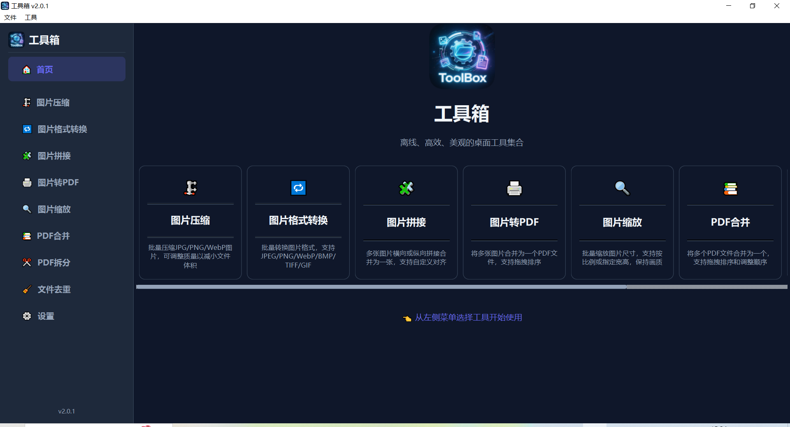

# ToolBox

  [](https://github.com/yansheng836/python-toolbox/issues) [](https://github.com/yansheng836/python-toolbox/pulls) [](https://github.com/yansheng836/python-toolbox/tags) [](https://github.com/yansheng836/python-toolbox/releases)   [](https://app.codacy.com/gh/yansheng836/python-toolbox/dashboard?utm_source=gh&utm_medium=referral&utm_content=&utm_campaign=Badge_grade) [](https://github.com/yansheng836/python-toolbox/blob/main/LICENSE.txt)

[](https://github.com/yansheng836/python-toolbox)

<div align="center" markdown="1">

**Offline · Efficient · Beautiful** — a desktop toolbox for everyday file processing

[Features](#features) · [Screenshots](#screenshots) · [Quick Start](#quick-start) · [Usage Guide](#usage-guide) · [Plugin Development](#plugin-development) · [User Manual](UserManual.en.md)

English \| [简体中文](README.md)

</div>

---

## Features

| Icon | Tool | Description |
|:----:|------|-------------|
| 🗜️ | **Image Compressor** | Batch-compress JPG/PNG/WebP with adjustable quality; supports format conversion |
| 🔁 | **Image Format Converter** | Batch-convert between six formats: JPEG/PNG/WebP/BMP/TIFF/GIF |
| 🧩 | **Image Stitcher** | Merge multiple images into one horizontally or vertically, with alignment options |
| 🖨️ | **Image to PDF** | Combine multiple images into a single PDF; supports drag-and-drop reordering |
| 🔍 | **Image Scaler** | Batch-resize images by percentage, width, or height |
| 📚 | **PDF Merger** | Merge multiple PDFs into one; supports drag-and-drop reordering |
| ✂️ | **PDF Splitter** | Split a PDF into images or single-page PDFs; supports custom page counts |
| 🧹 | **File Deduplicator** | Finds duplicate files by size pre-filtering + content hashing; supports rule-based sorting preview |
| 🗑️ | **Empty Folder Cleaner** | Recursively find and delete completely empty folders, including nested empty directories |

### Common Features

- 🌙 **Dark/Light themes** — one-click switching with automatic preference memory
- 🌐 **Bilingual UI (Chinese/English)** — chosen automatically from the system language, switchable in Settings anytime
- 🖱️ **Drag-and-drop** — most tools accept files dragged directly into the list
- 📊 **File list** — a consistent experience with add/remove/reorder/clear
- 📈 **Progress display** — real-time progress and status updates
- 🔌 **Fully offline** — everything runs locally; no data ever leaves your machine
- 🧩 **Plugin extensibility** — drop a Python file into `plugins/` and it loads automatically
- ↔️ **Collapsible sidebar** — toggle via the collapse button or the `Ctrl+B` shortcut
- 🧭 **Navigation management** — reorder tools by dragging or hide them in Settings; the sidebar and home page update instantly
- ↩️ **Reset to defaults** — restore language, theme, window layout, and more in one click

---

## Screenshots

| Feature | Screenshot |
|:---:|:---:|
| **Home** |  |
| **Image Compressor** |  |
| **Image Format Converter** |  |
| **Image Stitcher** |  |
| **Image to PDF** |  |
| **Image Scaler** |  |
| **PDF Merger** |  |
| **PDF Splitter** |  |
| **File Deduplicator** |  |
| **Settings** |  |

---

## Quick Start

### 1. Install Dependencies

```bash
pip install -r requirements.txt
```

**Package overview:**

| Package | Purpose |
|---------|---------|
| PyQt6 | GUI framework |
| Pillow (PIL) | Image processing |
| img2pdf | PDF conversion |
| PyMuPDF (fitz) | PDF conversion |

### 2. Run the Application

```bash
python main.py
```

### 3. Build an EXE (Windows)

```bash
# Recommended: build from the spec file (includes all required modules)
pyinstaller toolbox.spec

# Compress with UPX to reduce size
pyinstaller --upx-dir=/path/to/upx toolbox.spec
```

> ⚠️ **Note**: Always build with `toolbox.spec`. Running `pyinstaller main.py` directly will miss the dynamically loaded plugin modules.

---

## Usage Guide

### Image Compressor

1. Click "Image Compressor" in the left sidebar
2. Add images (multi-select and drag-and-drop supported)
3. Choose the output format (Keep original / JPG / PNG / WebP)
4. Adjust the quality slider (70–85% recommended)
5. Click "Start Compression"

### Image Format Converter

1. Click "Image Format Converter" in the left sidebar
2. Add images and pick a target format (JPEG / PNG / WebP / BMP / TIFF / GIF)
3. Adjust the conversion quality
4. Click "Start Conversion"

### Image Stitcher

1. Click "Image Stitcher" in the left sidebar
2. Add images (at least 2) and arrange their order
3. Choose the stitch direction: horizontal / vertical
4. Set the output image quality
5. Click "Start Stitching"

### Image to PDF

1. Click "Image to PDF" in the left sidebar
2. Add images (drag-and-drop reordering supported)
3. Choose the output quality (High / Standard / Compressed)
4. Choose the output file path
5. Click "Start Conversion"

### Image Scaler

1. Click "Image Scaler" in the left sidebar
2. Add images and choose a scaling mode (percentage / width / height)
3. Set the scaling parameters and check "Maintain Aspect Ratio"
4. Click "Start Scaling"

### PDF Merger

1. Click "PDF Merger" in the left sidebar
2. Add PDF files (drag-and-drop reordering supported)
3. Arrange the PDF order (move up / move down)
4. Choose the output file path
5. Click "Start Merge"

### PDF Splitter

1. Click "PDF Splitter" in the left sidebar
2. Add one PDF file
3. Choose the output format (single-page PDFs / images)
4. Set the pages-per-file (single-page PDF mode) or the image format (image mode)
5. Click "Start Splitting"

### File Deduplicator

1. Click "File Deduplicator" in the left sidebar
2. Click "Browse" to choose a folder to scan (or drag a folder into the input box); scanning starts automatically (three-stage filtering: file size → quick hash → full hash, for a major speedup)
3. Choose a deduplication rule and click "Sort by Rule" to preview keep/delete markers
4. After reviewing, check the groups you want to clean up
5. Click "Delete Duplicates" and confirm

### Empty Folder Cleaner

1. Click "Empty Folder Cleaner" in the left sidebar
2. Choose the root folder to clean (or drag a folder into the input box)
3. Click "Start Scan" to recursively find completely empty folders (a directory tree containing only empty subfolders counts as empty)
4. Check the folders to delete in the results list ("Select All" / "Deselect All" supported)
5. Click "Delete Selected Folders" and confirm

> 💡 The scan root is always kept, and deletion only uses `os.rmdir` — no file is ever removed. Symbolic links and junctions are skipped.

---

## Plugin Development

ToolBox supports plugins. Drop a Python file into the `plugins/` directory and it will be loaded automatically.

### Creating a Plugin

Create `plugins/my_tool.py`:

```python
# -*- encoding: utf-8 -*-
"""
My tool plugin
"""
from toolbox import ToolPlugin, Card, AnimatedButton, Theme
from PyQt6.QtWidgets import QWidget, QVBoxLayout, QLabel

class MyTool(ToolPlugin):
    name = "我的工具"
    description = "工具描述"
    icon = "🔧"

    def create_ui(self) -> QWidget:
        """Create the tool UI"""
        widget = QWidget()
        layout = QVBoxLayout(widget)
        layout.addWidget(QLabel("Hello, World!"))
        return widget

    def update_theme(self, theme):
        """Respond to theme switches (required)"""
        pass
```

### Plugin Configuration

Add an entry to the `PLUGIN_MODULES` list in `config.py`:

```python
PLUGIN_MODULES = [
    # ... other plugins ...
    {
        "id": "my_tool",
        "name": "我的工具",
        "icon": "🔧",
        "description": "工具描述",
        "order": 30,  # sort weight; lower values come first
        "module": "plugins.my_tool",
        "class": "MyTool",
    },
]
```

### Existing Plugins

| File | Class | Function |
|------|-------|----------|
| `plugins/image_compressor.py` | `ImageCompressor` | Image compression |
| `plugins/image_format_converter.py` | `FormatConverter` | Image format conversion |
| `plugins/image_stitcher.py` | `ImageStitcher` | Image stitching |
| `plugins/image_to_pdf.py` | `ImageToPDF` | Image to PDF |
| `plugins/image_scaler.py` | `ImageScaler` | Image scaling |
| `plugins/pdf_merger.py` | `PDFMerger` | PDF merging |
| `plugins/pdf_splitter.py` | `PDFSplitter` | PDF splitting |
| `plugins/file_deduplicator.py` | `FileDeduplicator` | File deduplication |
| `plugins/empty_folder_cleaner.py` | `EmptyFolderCleaner` | Empty folder cleanup |

---

## Configuration System

Static configuration lives in `config.py`:

| Setting | Description |
|---------|-------------|
| `APP_NAME`, `APP_VERSION` | Application name and version |
| `APP_DESCRIPTION`, `APP_COPYRIGHT` | Application description and copyright |
| `APP_WEBSITE_URL` | Official website link |
| `PLUGIN_MODULES` | Plugin list (name, icon, description, order) |
| `UI_CONFIG` | Window size, sidebar width, and other UI settings |
| `THEME_CONFIG` | Theme-related configuration |
| `WELCOME_CONFIG` | Welcome page text content |

Edit `config.py` to customize the app's appearance and info without touching the main program.

### Runtime Configuration (config.ini)

At runtime the app also reads and writes `config.ini` to persist user settings:

| Item | Description |
|------|-------------|
| Default location | Windows: `%LOCALAPPDATA%\Toolbox\config.ini`; macOS: `~/Library/Application Support/Toolbox/config.ini` |
| Portable mode | If a writable `portable.flag` exists next to the executable (project root when running from source), `config.ini` is stored in the same directory |
| Stored settings | `[general]` UI language and theme, `[window]` window geometry and state, `[nav]` navigation order and tool visibility, `[meta]` config version |
| First launch | The file is created with defaults if missing; the UI language is initialized from the system language (Chinese → `zh_CN`, otherwise → `en`), a notice dialog appears after this first automatic setup, and later changes made on the Settings page take precedence |
| Legacy migration | Theme and window geometry/state are imported from the legacy `QSettings` registry only when the INI has no value yet; registry data is not deleted |
| Write safety | The old file is backed up as `config.ini.bak` and replaced atomically via a temp file; missing or corrupt files fall back to defaults with an error logged; if the config directory is not writable, settings apply to the current run only |

The file is managed by `AppSettings` in `common/app_settings.py` and normally does not need manual editing.

---

## Building & Release

### Requirements

- Python 3.10+ (required by PyQt6/PyMuPDF)
- Windows (other platforms may work after adjusting the spec file; macOS can use `build_macos.py`)

### Build Steps

```bash
# 1. Generate the version info file
python generate_version_info.py

# 2. Verify packaging dependencies
python verify_packaging.py

# 3. Build the EXE
pyinstaller toolbox.spec
```

The built EXE is located in the `dist/` directory.

---

## TODO

### Completed ✅

- [x] Image compression (batch, adjustable quality)
- [x] Image format conversion (JPEG/PNG/WebP/BMP/TIFF/GIF)
- [x] Image stitching (horizontal/vertical)
- [x] Image to PDF (multi-image merge)
- [x] Image scaling (percentage / width / height)
- [x] PDF merging (multi-file merge)
- [x] PDF splitting (into images or single-page PDFs)
- [x] File deduplication (by content hash)
- [x] Empty folder cleanup (recursive empty-directory removal)
- [x] Dark/light theme switching
- [x] Bilingual UI (Chinese/English)
- [x] Navigation reorder and hide
- [x] Reset to defaults
- [x] Automatic plugin discovery and loading

### Planned 🔨

- [ ] Batch image watermarking (text or image watermark)
- [ ] Batch image rotation/flipping
- [ ] Batch image cropping
- [ ] Batch file renaming (regex, numbering, and date rules)

### Pending Improvements

None yet

---

PRs are welcome for new plugins and features!

---

## License

This project is open source under the [MIT License](./LICENSE.txt). Feel free to use and contribute.

## Star History

[](https://star-history.com/#yansheng836/python-toolbox&Timeline)

## Visitors

<a href="https://info.flagcounter.com/nYwQ"></a>

---

<div align="center" markdown="1">

**ToolBox** — Making file processing simpler 🚀

</div>
