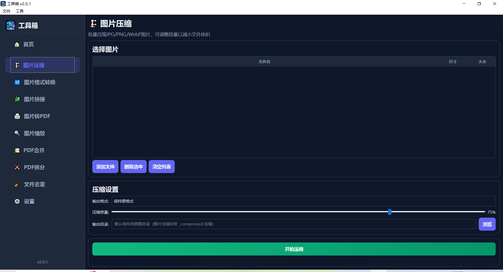
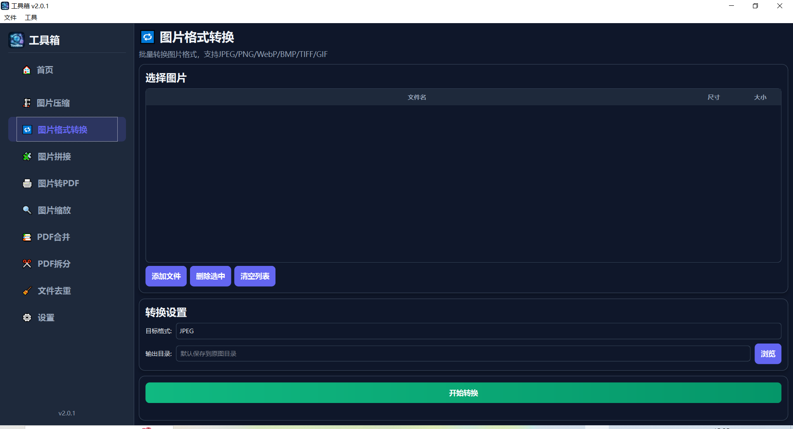
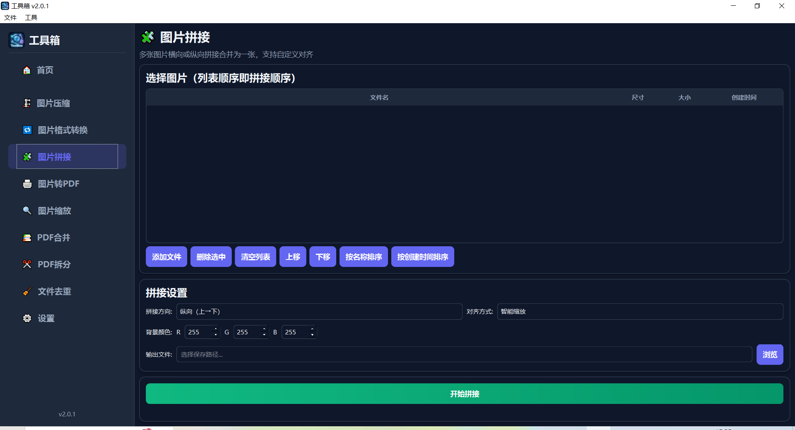
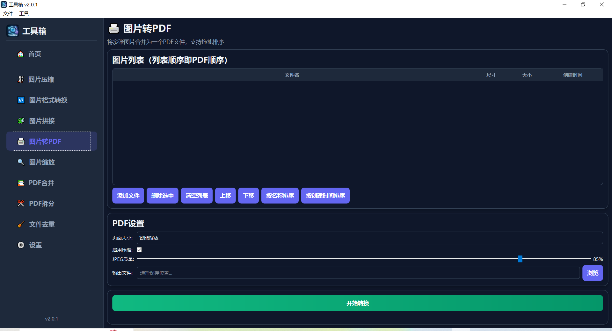
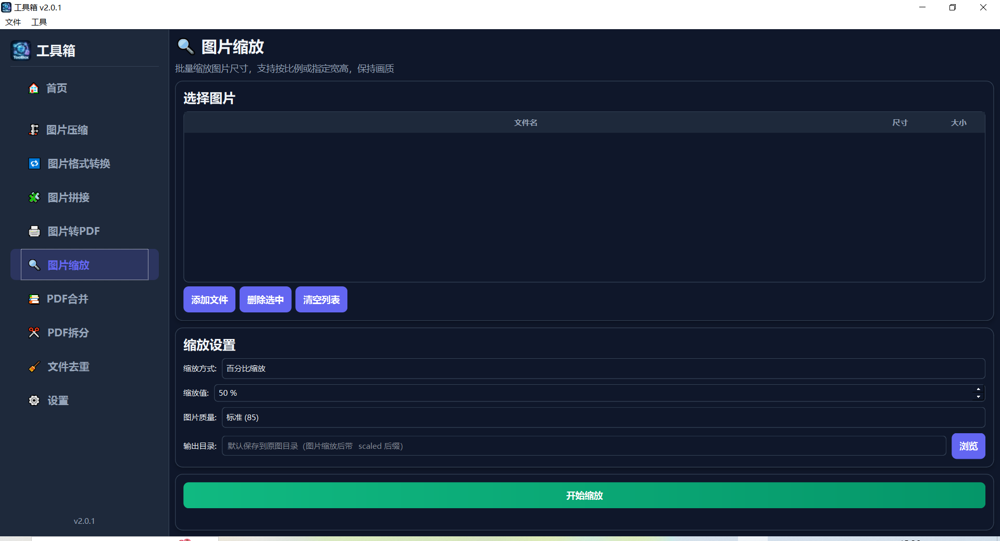
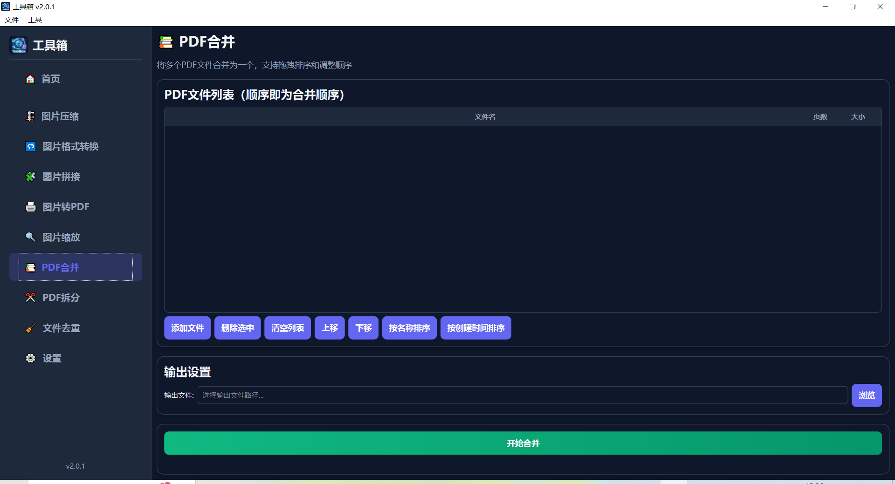
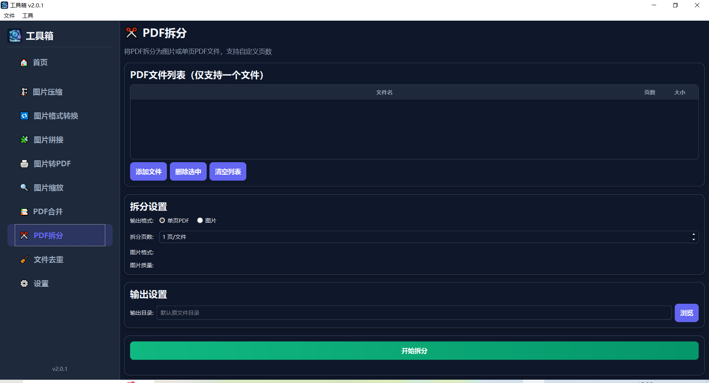
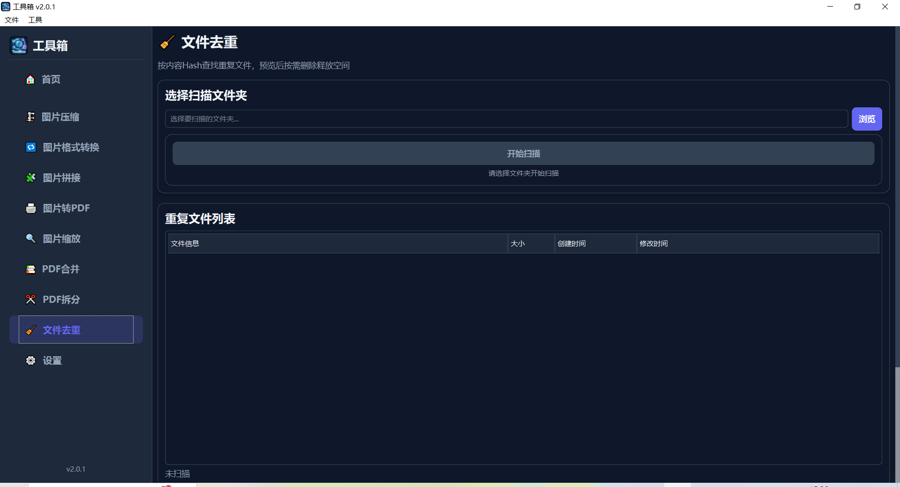
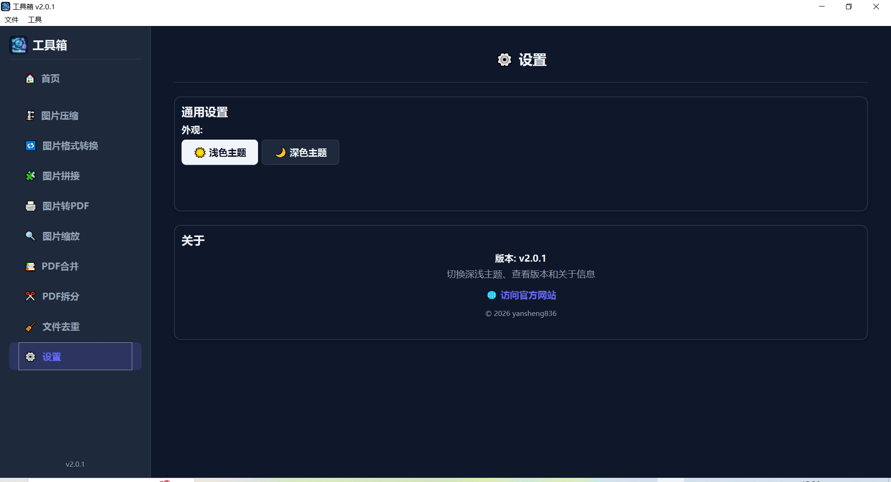

# ToolBox — User Manual

Welcome to **ToolBox**! It is an offline, efficient, and beautiful desktop toolbox that helps you handle images and PDF files with ease.

[English](UserManual.en.md) | [简体中文](用户手册.md)

---

## Quick Start

1. Double-click the ToolBox program to open it
2. You will see the tool menu on the left and the content area on the right
3. Click any tool name on the left to start using it
4. The home page on the right shows all available features; you can also jump in from there

> 💡 **Tip**: Hover over the left menu to see each tool's icon and name.

---

## Interface Overview

The ToolBox interface has two main parts:

### Left: Tool Menu

- Lists all available tools
- Click a tool name to switch to that feature
- Click the arrow button on the right edge of the sidebar to collapse/expand the menu; when collapsed, only icons are shown, saving workspace space
- Child widgets fade in/out during collapse/expand for a smoother transition
- Press `Ctrl+B` to quickly toggle the sidebar collapse/expand state
- The "Settings" entry at the bottom lets you switch themes, manage navigation, or view about info

### Right: Workspace

- **Home page**: shows all features; click a card to jump in quickly
- **Tool pages**: each tool's UI, containing the file list, action buttons, progress display, etc.
- **Settings page**: switch between dark/light themes, manage navigation, and view app info

### Common UI Elements

| Element | Description |
|---------|-------------|
| 📄 Add Files (💡 drag-and-drop supported) | Click to pick files into the list; you can also drag files directly onto the button |
| 🗑️ Remove Selected | Remove the selected files from the list |
| 🧹 Clear List | Clear the entire file list |
| ⬆ Move Up / ⬇ Move Down | Adjust a file's position in the list (supported by some tools) |
| 🔀 Sort by Name | Sort the list by file name |
| ⏰ Sort by Creation Time | Sort the list by file creation time |
| 🏁 Start | Runs the current tool's task (each tool shows its own label, e.g. "Start Compression", "Start Conversion") |
| Progress bar | Shows task processing progress |
| Status label | Shows task status and result info |

---

## Feature Details

### Image Compressor

**What it does**: Batch-compress JPG, PNG, and WebP images to reduce file size for easier sharing and storage.

**Steps**:

1. Click "Image Compressor" in the left menu
2. Click "Add Images" and select the images to compress (multi-select supported)
3. Pick a format in the "Output Format" dropdown:
   - **Keep original format**: the format stays unchanged after compression
   - **JPG / JPEG**: convert to JPG
   - **PNG**: convert to PNG
   - **WebP**: convert to WebP (smaller size)
4. Drag the "Compression Quality" slider (1–100%):
   - Higher values mean better quality and larger files
   - 70–85 is recommended as a good balance of quality and size
5. Choose the output directory (optional; defaults to the original images' directory)
6. Click "Start Compression"
7. Wait for processing to finish and check the result message

> 📌 **When to use**: Email attachment too large to send? WeChat compressing your photos? Compress them in batch with this tool before sharing!

---

### Image Format Converter

**What it does**: Batch-convert images to another format. Supports JPEG, PNG, WebP, BMP, TIFF, and GIF.

**Steps**:

1. Click "Image Format Converter" in the left menu
2. Click "Add Images" and select the images to convert (multi-select supported)
3. Pick the target format in the "Target Format" dropdown
4. Choose the output directory (optional)
5. Click "Start Conversion"
6. Wait for processing to finish

> 📌 **When to use**: A website requires PNG uploads but you only have JPG? Batch-convert, done in one click!

---

### Image Stitcher

**What it does**: Stitch multiple images into one large image, either horizontally (left to right) or vertically (top to bottom).

**Steps**:

1. Click "Image Stitcher" in the left menu
2. Click "Add Images" and select at least 2 images
3. Arrange the image order (with the "Move Up" / "Move Down" buttons)
4. Choose the stitch direction:
   - **Horizontal**: images are laid out left to right
   - **Vertical**: images are laid out top to bottom
5. Choose an alignment mode:
   - **Top/Left align**: align to the first image's top (horizontal) or left edge (vertical); the rest is filled with blank space
   - **Center align**: all images are center-aligned
   - **Bottom/Right align**: align to the last image's bottom (horizontal) or right edge (vertical)
   - **Smart Scale** (default): automatically scales images proportionally to fit the canvas and fills the background
6. In Smart Scale mode, you can set the background color (R/G/B values, 0–255; white by default)
7. Click "Browse" to choose the output file path
8. Click "Start Stitching"
9. Wait for processing to finish (with many or very large images, output is automatically split into multiple files)

> 📌 **When to use**: Stitch screenshots into one long image for sharing? Combine photos into one for comparison? This is the tool for it!

---

### Image to PDF

**What it does**: Combine multiple images into a single PDF file; supports drag-and-drop reordering.

**Steps**:

1. Click "Image to PDF" in the left menu
2. Add images in one of these ways:
   - Click "Add Images" to pick files
   - Drag image files directly into the file list area
3. Arrange the image order (with "Move Up" / "Move Down", "Sort by Name", or "Sort by Creation Time")
4. Set the page size:
   - **Auto Fit**: generate each page at the image's original size
   - **A4**: output as uniform A4 pages
   - **A3**: output as uniform A3 pages
   - **Original Size**: output at each image's actual pixel size
   - **Smart Scale** (default): automatically scales images to a suitable size, balancing readability and file size
5. Check "Enable Compression" to reduce the output PDF size (checked by default)
6. When compression is enabled, drag the "JPEG Quality" slider to adjust the compression level
7. Click "Browse" to choose the output PDF file path
8. Click "Start Conversion"
9. Wait for processing to finish

> 📌 **When to use**: Pack multiple photos into one PDF for a client? Merge scanned pages into one document? Easy!

---

### Image Scaler

**What it does**: Batch-resize images by percentage or to a specific width/height.

**Steps**:

1. Click "Image Scaler" in the left menu
2. Click "Add Images" and select the images to resize (multi-select supported)
3. Choose a scaling mode:
   - **Percentage**: enter a percentage (e.g. 50% to halve the size)
   - **Specify Width**: enter the target width; height adjusts proportionally
   - **Specify Height**: enter the target height; width adjusts proportionally
4. In "Specify Width" or "Specify Height" mode, check "Keep Aspect Ratio" to prevent distortion (recommended)
5. Pick the output quality in the dropdown:
   - **High Quality**: best image quality, larger files
   - **Standard**: balance of quality and size
   - **Small File**: slightly lower quality, smaller files
   - **Smallest File**: smallest files, lowest quality
6. Choose the output directory (optional)
7. Click "Start Scaling"
8. Wait for processing to finish

> 📌 **When to use**: A website requires images no wider than 800 pixels? Resize hundreds of images at once? One click away!

---

### PDF Merger

**What it does**: Merge multiple PDF files into one; supports drag-and-drop reordering.

**Steps**:

1. Click "PDF Merger" in the left menu
2. Add PDF files in one of these ways:
   - Click "Add PDFs" to pick files
   - Drag PDF files directly into the file list area
3. Arrange the PDF order (with "Move Up" / "Move Down" or "Sort by Name" / "Sort by Creation Time")
4. Click "Browse" to choose the output PDF file path
5. Click "Start Merge"
6. Wait for the merge to finish

> 📌 **When to use**: Combine multiple reports into one document? Consolidate several scanned PDFs into a single file? Use this tool!

---

### PDF Splitter

**What it does**: Split one PDF into multiple smaller files — either by a fixed page count or by exporting each page as an image.

**Steps**:

1. Click "PDF Splitter" in the left menu
2. Click "Add PDFs" and select one PDF file
3. Choose the output format:
   - **Single-page PDFs**: every N pages produce one PDF file
   - **Images**: export each page as an image (JPG/PNG/WebP)
4. If you chose "Single-page PDFs":
   - Set "Pages per File" (set to 1 for one PDF per page; set to 5 for one PDF every 5 pages)
5. If you chose "Images":
   - Pick the image format (JPG/PNG/WebP)
   - Set the image quality slider
6. Choose the output directory (defaults to the original file's directory)
7. Click "Start Splitting"
8. Wait for processing to finish

> 📌 **When to use**: Split a 100-page PDF into single pages for sharing? Convert a PDF to images for a document? This tool has you covered!

---

### File Deduplicator

**What it does**: Scans a folder for files with identical content (computed from file content, not file names) and helps you clean up duplicates to save space. Uses a three-stage filtering strategy (file size → quick hash → full hash) to greatly speed up scanning.

**Steps**:

1. Click "File Deduplicator" in the left menu
2. Click "Choose Folder", select the folder to scan, and scanning starts automatically
3. Wait for the scan to finish; results are grouped as duplicate groups in a tree list
4. Choose a deletion rule (6 options in the dropdown):
   - **Creation time ascending** (earliest-created files are kept, later ones deleted)
   - **Creation time descending** (newest-created files are kept, older ones deleted)
   - **File name ascending** (A→Z; names earlier in sort order are kept)
   - **File name descending** (Z→A; names later in sort order are kept)
   - **Smart copy detection (creation time ascending)** (deletes files marked as copies like `(1)`/`_copy`/`_backup`/`.temp` first, then sorts the rest by creation time)
   - **Smart copy detection (creation time descending)** (same as above, but keeps files created later first)
5. Click "Sort by Rule" to preview the keep/delete markers in each group (✅ keep / ❌ delete)
6. Use "Select All", "Deselect All", and "Collapse" to manage file groups quickly
7. Check the duplicate groups you want to process
8. Check "Rescan after deletion" to automatically rescan when deletion completes, for continuous cleanup
9. Click "Delete Duplicates"
10. Review the deletion list in the confirmation dialog and click "Confirm" to finish

> 💡 **Tip**: Smart copy detection treats files with markers like `(1)`, `_copy`, `_backup`, and `.temp` as copies first; the rest are sorted by creation time, with earlier-created files more likely to be kept.

> ⚠️ **Warning**: Double-check before deleting! Back up important files first. Deduplication cannot be undone. Read-only files are automatically made writable before deletion.

> 📌 **When to use**: Lots of duplicate photos after transferring from your phone? Downloaded files scattered with duplicates? Scan once and find them all!

---

## Settings & Themes

### Switching Themes

ToolBox supports dark and light themes:

1. Click "⚙ Settings" at the bottom of the left menu
2. In the "Theme" section, click "Dark Theme" or "Light Theme"
3. The UI switches immediately; your choice is remembered and applied on next launch

| Theme | Description |
|-------|-------------|
| 🌙 Dark Theme | Black background, easy on the eyes; great at night or in dim environments |
| ☀️ Light Theme | White background, clear and bright; great for daytime use |

### Navigation Management

In "Settings → Navigation", you can customize the order and visibility of the tools in the sidebar (the list does not include "Settings" itself):

1. **Reorder**: drag a list item up or down to change the tool order; the sidebar menu and the home page cards update immediately
2. **Hide a tool**: uncheck a tool to hide it from the sidebar and home page; the tool itself is still loaded with the app, and checking it again restores it
3. **Show All**: click "Show All" to check every tool again (the order is kept)
4. **Reset Order**: click "Reset Order" to return both the order and visibility to their defaults (the built-in default order, all tools visible)

All changes take effect immediately and are written to the config file automatically — there is no "Save" button. The "Settings" page is always shown at the end of the sidebar; it cannot be hidden and does not take part in sorting.

> 📌 **Tip**: If you hide every tool, the sidebar only keeps "Home" and "Settings", and the home page shows a hint: "All tools are hidden. Restore them in Settings → Navigation." The "Reset to Defaults" button at the bottom of the settings page also restores the default navigation order and visibility.

### About ToolBox

At the bottom of the settings page you can find:

- App name and version
- Official website link (clickable)
- Copyright info

---

## FAQ

### Q: Do the tools need an internet connection?

**A**: No! ToolBox runs fully offline. All processing happens on your computer and no files are ever uploaded, protecting your privacy.

### Q: Which image formats are supported?

**A**: Common formats including JPG, PNG, WebP, BMP, TIFF, and GIF.

### Q: Is processing large files slow?

**A**: ToolBox uses efficient processing and usually finishes within seconds. More/larger files take proportionally longer, with a progress bar showing status.

### Q: Can deleted files be recovered?

**A**: Files deleted by the "File Deduplicator" cannot be recovered directly. Always double-check before deleting, and back up important files first.

### Q: Where are output files saved?

**A**: Every tool lets you choose an output directory. If not set, files are generally saved next to the originals, with suffixes like "_compressed" or "_scaled" to distinguish them.

### Q: Can I use multiple tools at the same time?

**A**: Yes! Clicking different tools in the left menu switches the workspace. You can switch to another tool after one finishes processing.

### Q: What's the difference between dark and light themes?

**A**: Appearance only. Dark theme has a darker background for dim environments; light theme has a brighter background for well-lit ones. Features are identical — pick whatever you like.

### Q: Why are some buttons grayed out?

**A**: Usually because no files have been added yet, or a required option (such as the output path) is missing. Once files are added and required info is filled in, the buttons become available automatically.

---

*User manual version: v2.0.6 | Corresponding app version: v2.0.6*
